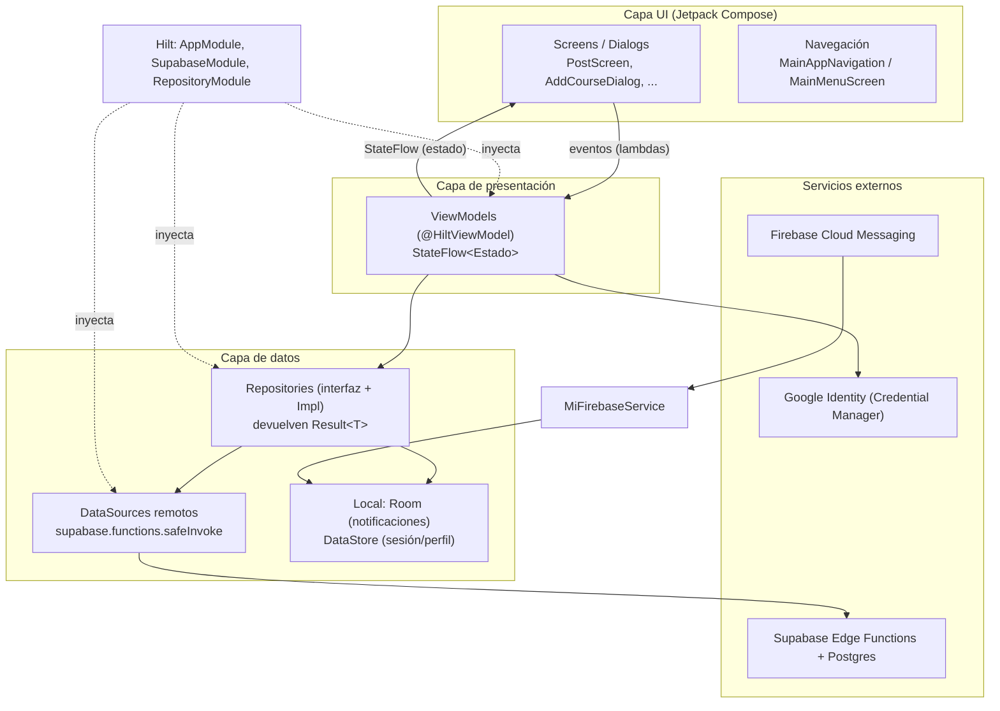

# Examen 1 – 2026B · Introducción al Desarrollo de Nuevas Plataformas (E)

**Proyecto analizado:** AlertaUNI (`com.erns.alertauni`) – Android · Jetpack Compose · Hilt · Supabase · Firebase Cloud Messaging
**Grupo:** B7 — Adrian Issac Mamani Quispe · Daniel Wilston Chura Monroy · Johann Andre Cáceres Ruiz · Daniel Bedregal Pérez · Yourdyy Yossimar Huayhua Hillpa
**Rama de trabajo:** `examen1`

---

## 0. Alcance y metodología

El objetivo es **comprender** el aplicativo entregado, **evaluar y mejorar** funcionalidades existentes y **proponer su evolución** manteniendo la arquitectura actual.

Método seguido:

1. **Lectura estructural**: inventario de paquetes y capas (`screen/`, `navigation/`, `data/`, `domain/`, `services/`, `security/`) y del backend (`Backend/supabase/functions`) junto con el modelo de datos (`Docs/Modelo base datos.png`).
2. **Trazado de casos de uso**: para cada funcionalidad se siguió el camino *acción del usuario → Composable → evento → ViewModel → Repository → DataSource → Edge Function → nuevo estado → recomposición*.
3. **Contraste con el uso real**: cada flujo se evaluó desde la perspectiva de un docente/estudiante real (errores, red lenta, rotación, estados vacíos, permisos, seguridad).
4. **Alcance según el enunciado**:
   - **Punto 2 (evaluación): sólo análisis y propuesta.** No se modificó el código de la app; los fragmentos de código del punto 2 son ilustrativos.
   - **Punto 3 (evolución): desarrollo técnico con implementación parcial** de una propuesta, como evidencia de viabilidad, con el alcance y su justificación explícitos.

> Nota de verificación: el repositorio no incluye `google-services.json` ni las claves reales de Supabase (`SupabaseModule` usa `"https://myurl.supabase.co"`), por lo que la app no puede ejecutarse contra el backend real. El prototipo del punto 3 se verificó compilando el APK (`./gradlew :app:assembleDebug`, incluye Hilt y Room) con un `google-services.json` de prueba no incluido en el repositorio.

---

## 1. Comprensión del aplicativo actual (C3)

### 1.1 Arquitectura general

La app sigue **MVVM con flujo de datos unidireccional (UDF)** y una arquitectura en capas inspirada en la guía oficial de Android:



| Capa | Componentes | Responsabilidad |
|---|---|---|
| UI | `@Composable` screens, `AlertDialog`, `LazyColumn`, `Scaffold`, `NavigationBar`, `FloatingActionButton`, `SnackbarHost` | Dibujar el estado y emitir eventos. Estado efímero de UI con `remember { mutableStateOf() }` (diálogo abierto, texto escrito). |
| Presentación | `LoginViewModel`, `PostViewModel`, `PostCommentViewModel`, `CourseViewModel`, `ContactViewModel` | Mantener el estado con `MutableStateFlow` privado + `StateFlow` público; lanzar corrutinas en `viewModelScope`; sobrevivir a cambios de configuración. |
| Dominio/sesión | `DataStoreHelper` (Preferences DataStore) | Guardar email, nombres, tipo de usuario, token FCM. |
| Datos | `*Repository` (interfaz) + `*RepositoryImpl`; `*DataSource` | El repositorio traduce excepciones a `Result<T>`; el DataSource invoca Edge Functions de Supabase. |
| Infraestructura | Hilt (`@HiltAndroidApp`, `@AndroidEntryPoint`, `@Module`), `SupabaseClient` (Auth + Functions), `MiFirebaseService`, Room | Inyección de dependencias, red, push y persistencia local. |

**Decisiones técnicas relevantes observadas**

- **Inversión de dependencias**: los ViewModels dependen de interfaces (`PostRepository`), enlazadas con `@Binds` en `RepositoryModule`. Permite sustituir la implementación (p. ej. un *fake* para pruebas).
- **Backend como "BFF" en Edge Functions**: la app no consulta tablas directamente (Postgrest está desactivado en `SupabaseModule`), sino funciones como `service-posts`, que validan el perfil (`_shared/auth2.ts`) y filtran por curso.
- **Manejo de errores centralizado**: `Functions.safeInvoke` (`common/Wrappers.kt`) convierte respuestas 401/404 con cuerpo `{code, message}` en `BackendException(BackendError)`.
- **Estados como `sealed class`**: `AuthState`, `PostState`, `CommentState`, `CourseState`, y el genérico `ResourceState<T>` (definido pero no usado).
- **Paso de argumentos por navegación**: `PostCommentViewModel` obtiene `postId` desde `SavedStateHandle`, que Navigation Compose rellena a partir de la ruta `comment/{postId}`.

### 1.2 Arranque y navegación

```mermaid
sequenceDiagram
    actor U as Usuario
    participant A as MainActivity
    participant NAV as MainAppNavigation
    participant L as LoginScreen / LoginViewModel
    participant G as Credential Manager (Google)
    participant SB as Supabase Auth + service-check-profile
    participant M as MainMenuScreen

    A->>NAV: setContent { AlertaUNITheme { MainAppNavigation() } }
    NAV->>L: startDestination = "login"
    U->>L: Toca "Autenticación con Google"
    L->>G: getCredential(GetGoogleIdOption)
    G-->>L: idToken, givenName, familyName
    L->>SB: auth.signInWith(IDToken) → checkProfile()
    alt Perfil existe
        SB-->>L: {user_email, user_type}
        L->>L: DataStore.setUserType(); authState = Authenticated
        L-->>NAV: onLoginSuccess(userType)
        NAV->>M: MainMenuScreen(userType)
    else Perfil no existe (404 PROFILE_NOT_FOUND)
        L->>L: authState = IncompleteProfile
        L-->>NAV: onIncompleteProfile() → navigate("profile")
        U->>NAV: elige Docente/Estudiante → service-update-profile
        NAV->>M: MainMenuScreen(userType)
    end
```

- Hay **dos niveles de navegación**: `MainAppNavigation` (login/perfil) y un segundo `NavHost` dentro de `MainMenuScreen` (pestañas).
- El menú inferior se construye **según el rol**: `PROFESSOR` → Posts, Contactos (docente), Cursos; `STUDENT` → Posts, Contactos (estudiante), Cursos.
- El `FloatingActionButton` es **compartido**: cada pantalla registra su acción con `onFabActionReady { ... }` y el `Scaffold` la ejecuta (patrón de *state hoisting* de la acción).

### 1.3 Funcionalidades identificadas

| # | Funcionalidad | Usuario | Pantalla / ViewModel | Edge Function |
|---|---|---|---|---|
| F1 | Inicio de sesión con Google | Ambos | `LoginScreen` / `LoginViewModel` | Supabase Auth, `service-check-profile` |
| F2 | Completar perfil y elegir rol | Ambos (primera vez) | `ProfileScreen` / `LoginViewModel` | `service-update-profile` |
| F3 | Menú principal por rol | Ambos | `MainMenuScreen` | – |
| F4 | Tablero de anuncios (públicos + privados propios) | Ambos | `PostScreen` / `PostViewModel` | `service-posts` (RPC `get_posts_fun`) |
| F5 | Publicar anuncio a un curso | Docente | `AddPostDialog` / `PostViewModel` | `service-course-catalog`, `service-post-add` |
| F6 | Conversación grupal (comentarios) de un anuncio | Ambos | `PostCommentScreen` / `PostCommentViewModel` | `service-comments`, `service-comment-add` |
| F7 | Anuncio privado docente → estudiante y su hilo privado | Docente / Estudiante | `TeacherContactScreen`, `AddCommentPrivateDialog` / `ContactViewModel` | `service-course-student`, `service-post-private-add` |
| F8 | Contactar por correo al estudiante | Docente | `TeacherContactStudentCard` (Intent `ACTION_SEND`) | – |
| F9 | Ver cursos en los que participa | Ambos | `StudentCourseScreen` / `CourseViewModel` | `service-student-enrollment` |
| F10 | Unirse a un curso con código de clase | Estudiante | `AddCourseDialog` / `CourseViewModel` | `service-find-course-catalog`, `service-course-enroll` |
| F11 | Recepción de notificaciones push y guardado local | Ambos | `MiFirebaseService` + Room (`AppDatabase`) | FCM |
| F12 | Datos de sesión y "Recordar cuenta" | Ambos | `DataStoreHelper`, `SessionRepository` + `CryptoManager` | – |

#### F1 – Inicio de sesión con Google
- **Qué permite**: autenticarse con la cuenta institucional de Google, sin contraseña propia.
- **Componentes**: `CredentialManager` + `GetGoogleIdOption` (Jetpack Credential Manager), `GoogleIdTokenCredential`, `supabaseClient.auth.signInWith(IDToken)`; UI con `Row` clicable, `Image` desde *assets* (`AssetImageLoader`), `Checkbox`.
- **Estado y eventos**: `LoginViewModel` expone `authState: StateFlow<AuthState>` (`Loading`, `Unauthenticated`, `IncompleteProfile`, `CompleteProfile`, `Authenticated`). La pantalla lo observa con `collectAsState()` y reacciona en un `LaunchedEffect(authState.value)` que invoca los callbacks de navegación. El clic se propaga como lambda `btnAutenticar`.
- **Responsabilidades**: la UI sólo dibuja y delega; el ViewModel orquesta Google → Supabase → verificación de perfil y guarda datos en `DataStoreHelper`; `AuthRepositoryImpl` encapsula el SDK de Supabase y traduce `PROFILE_NOT_FOUND` a un evento global (`AppEventManager`).

#### F2 – Completar perfil y rol
- **Qué permite**: en el primer ingreso, confirmar nombres (obtenidos de Google, no editables) y elegir **Docente** o **Estudiante**.
- **Componentes**: `OutlinedTextField(enabled = false)`, `SingleChoiceSegmentedButtonRow` + `SegmentedButton` (Material 3), `Button`.
- **Estado y eventos**: la selección vive en `remember { mutableStateOf() }` dentro de la UI; al confirmar se llama `viewModel.updateUserProfile(...)` y el `LaunchedEffect` espera `AuthState.CompleteProfile` para continuar.
- **Backend**: `service-update-profile` inserta en `user_profile` con `user_type` 1 (docente) o 2 (estudiante).

#### F3 – Menú principal por rol
- `MainMenuScreen(userType)` arma la lista de `RouteMainMenu` según el rol y usa `NavigationBar` + `NavigationBarItem`; la navegación entre pestañas usa `popUpTo(startDestination) { saveState = true }`, `launchSingleTop` y `restoreState`, preservando el estado de cada pestaña.

#### F4 – Tablero de anuncios
- **Qué permite**: ver en orden los anuncios de todos los cursos del usuario, con curso, fecha, autor, visibilidad (Público/Privado) y número de comentarios.
- **Componentes**: `LazyColumn` + `items`, `Card` clicable, `UserInitialCircle`, `SearchBoxComponent` (cabecera).
- **Estado**: `PostViewModel.announcements: StateFlow<List<PostEntity>>`, cargado en `init`. `PostEntity` usa `@Serializable` + `@SerialName` para mapear el JSON.
- **Backend**: `service-posts` obtiene los `course_catalog_id` del usuario (`_shared/tools.ts`: por `professor_id` si es docente o por `student_enrollment` si es estudiante) y llama a la función SQL `get_posts_fun(course_ids, receiver_sender)`, que devuelve los anuncios públicos de esos cursos y los privados donde el usuario es emisor o receptor.

#### F5 – Publicar anuncio (docente)
- **Qué permite**: elegir uno de sus cursos, escribir título y contenido (máx. 280 caracteres) y publicar.
- **Componentes**: `AlertDialog`, `TextField` (con contador y recorte a 280 caracteres en `onValueChange`), selector propio con `OutlinedTextField(readOnly)` + `DropdownMenu` + `DropdownMenuItem`; ancho del menú calculado con `onGloballyPositioned` + `LocalDensity`.
- **Estado y eventos**: estado del formulario en la UI (`remember`); al publicar, `PostScreen` cierra el diálogo y llama `postViewModel.sendPost(...)`, que crea un `PostRequest` e invoca `service-post-add`. El FAB comprueba `catalogCourses` y muestra un `Snackbar` si no hay cursos.

#### F6 – Conversación grupal
- **Qué permite**: abrir un anuncio y conversar con estilo chat (burbujas propias a la derecha).
- **Componentes**: `LazyColumn(reverseLayout = true)`, `Surface` con `RoundedCornerShape` como burbuja, `TextField` con `trailingIcon` de envío.
- **Estado y eventos**: `PostCommentViewModel` recibe `postId` por `SavedStateHandle`; carga `comments` y, al enviar, agrega el comentario localmente (actualización optimista con `_comments.update { it + nuevo }`). `isMine` se calcula en el repositorio comparando el email del autor con el guardado en DataStore.

#### F7 – Anuncio privado y respuesta privada
- **Qué permite**: el docente elige un curso (`FilterChip`), ve la lista de estudiantes y envía a uno de ellos un anuncio privado. Ese anuncio aparece en el tablero **sólo** del docente y del estudiante receptor (filtro `receiver_sender` en `get_posts_fun`) con la etiqueta "Privado"; el hilo de comentarios de ese anuncio funciona como **canal de respuesta privada** del estudiante hacia el docente.
- **Componentes**: `FilterChip`, `LazyColumn`, `IconButton`, `AlertDialog`.
- **Estado**: `ContactViewModel` expone `studentEnrollmentList` y `students`; la selección de curso dispara `LaunchedEffect(courseSelected.value)` → `getStudentByCourse(...)`.

#### F8 – Correo al estudiante
- Toca el email → `Intent.ACTION_SEND` con `type = "message/rfc822"` y `Intent.createChooser`, lanzado con `rememberLauncherForActivityResult(StartActivityForResult)`. Delegar en apps del sistema evita reimplementar correo.

#### F9 y F10 – Cursos e incorporación por código
- **Qué permite**: listar cursos (código, nombre, tipo, grupo, docente) y, con el FAB, buscar un curso por **código de clase** y registrarse.
- **Componentes**: `LazyColumn`, `Card`, `AlertDialog` con `TextField` y botón de búsqueda.
- **Estado (versión original)**: `CourseViewModel` expone `studentEnrollment: StateFlow<StudentEnrollment?>` (curso encontrado) y `courseState` (`Loading/Saved/UnSaved`).
- **Backend**: `service-find-course-catalog` busca en `student_enrollment_view` por `class_code` con `class_code_enable = true` (el docente puede cerrar la inscripción).

#### F11 – Notificaciones push
- `MiFirebaseService` (`FirebaseMessagingService`, `@AndroidEntryPoint`) recibe el token (`onNewToken` → DataStore) y los mensajes (`onMessageReceived`): parsea el cuerpo JSON (`mensaje`, `fechahora`), muestra la notificación (`NotificationChannel` + `NotificationCompat`) y la guarda en Room (`NotificacionEntity`).
- **Comportamiento oculto**: las notificaciones se **persisten pero no existe ninguna pantalla que las muestre** (`NotificacionesViewModel` no se usaba). Esta observación motivó la funcionalidad del punto 3.

#### F12 – Sesión
- `DataStoreHelper` (Preferences DataStore, `@Singleton`) persiste perfil y preferencias. `SessionRepository` + `CryptoManager` implementan cifrado AES/GCM con **Android Keystore** para tokens, pero no están conectados al flujo actual.

