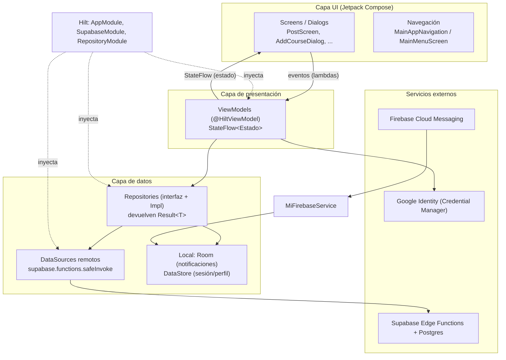

# Examen 1 – 2026B · Introducción al Desarrollo de Nuevas Plataformas (E)

**Proyecto analizado:** AlertaUNI (`com.erns.alertauni`) – Android · Jetpack Compose · Hilt · Supabase · Firebase Cloud Messaging
**Grupo:** B7 — Adrian Issac Mamani Quispe · Daniel Wilston Chura Monroy · Johann Andre Cáceres Ruiz · Daniel Bedregal Pérez · Yourdyy Yossimar Huayhua Hillpa
**Rama de trabajo:** `examen1`

---

## 0. Alcance y metodología

El objetivo es **comprender** el aplicativo entregado, **evaluar y mejorar** funcionalidades existentes y **proponer su evolución** manteniendo la arquitectura actual.

Método seguido:

1. **Lectura estructural**: inventario de paquetes y capas (`screen/`, `navigation/`, `data/`, `domain/`, `services/`, `security/`) y del backend (`Backend/supabase/functions`) junto con el modelo de datos (`Docs/Modelo base datos.png`).
2. **Trazado de casos de uso**: para cada funcionalidad se siguió el camino *acción del usuario → Composable → evento → ViewModel → Repository → DataSource → Edge Function → nuevo estado → recomposición*.
3. **Contraste con el uso real**: cada flujo se evaluó desde la perspectiva de un docente/estudiante real (errores, red lenta, rotación, estados vacíos, permisos, seguridad).
4. **Alcance según el enunciado**:
   - **Punto 2 (evaluación): sólo análisis y propuesta.** No se modificó el código de la app; los fragmentos de código del punto 2 son ilustrativos.
   - **Punto 3 (evolución): desarrollo técnico con implementación parcial** de una propuesta, como evidencia de viabilidad, con el alcance y su justificación explícitos.

> Nota de verificación: el repositorio no incluye `google-services.json` ni las claves reales de Supabase (`SupabaseModule` usa `"https://myurl.supabase.co"`), por lo que la app no puede ejecutarse contra el backend real. El prototipo del punto 3 se verificó compilando el APK (`./gradlew :app:assembleDebug`, incluye Hilt y Room) con un `google-services.json` de prueba no incluido en el repositorio.

---

## 1. Comprensión del aplicativo actual (C3)

### 1.1 Arquitectura general

La app sigue **MVVM con flujo de datos unidireccional (UDF)** y una arquitectura en capas inspirada en la guía oficial de Android:



| Capa | Componentes | Responsabilidad |
|---|---|---|
| UI | `@Composable` screens, `AlertDialog`, `LazyColumn`, `Scaffold`, `NavigationBar`, `FloatingActionButton`, `SnackbarHost` | Dibujar el estado y emitir eventos. Estado efímero de UI con `remember { mutableStateOf() }` (diálogo abierto, texto escrito). |
| Presentación | `LoginViewModel`, `PostViewModel`, `PostCommentViewModel`, `CourseViewModel`, `ContactViewModel` | Mantener el estado con `MutableStateFlow` privado + `StateFlow` público; lanzar corrutinas en `viewModelScope`; sobrevivir a cambios de configuración. |
| Dominio/sesión | `DataStoreHelper` (Preferences DataStore) | Guardar email, nombres, tipo de usuario, token FCM. |
| Datos | `*Repository` (interfaz) + `*RepositoryImpl`; `*DataSource` | El repositorio traduce excepciones a `Result<T>`; el DataSource invoca Edge Functions de Supabase. |
| Infraestructura | Hilt (`@HiltAndroidApp`, `@AndroidEntryPoint`, `@Module`), `SupabaseClient` (Auth + Functions), `MiFirebaseService`, Room | Inyección de dependencias, red, push y persistencia local. |

**Decisiones técnicas relevantes observadas**

- **Inversión de dependencias**: los ViewModels dependen de interfaces (`PostRepository`), enlazadas con `@Binds` en `RepositoryModule`. Permite sustituir la implementación (p. ej. un *fake* para pruebas).
- **Backend como "BFF" en Edge Functions**: la app no consulta tablas directamente (Postgrest está desactivado en `SupabaseModule`), sino funciones como `service-posts`, que validan el perfil (`_shared/auth2.ts`) y filtran por curso.
- **Manejo de errores centralizado**: `Functions.safeInvoke` (`common/Wrappers.kt`) convierte respuestas 401/404 con cuerpo `{code, message}` en `BackendException(BackendError)`.
- **Estados como `sealed class`**: `AuthState`, `PostState`, `CommentState`, `CourseState`, y el genérico `ResourceState<T>` (definido pero no usado).
- **Paso de argumentos por navegación**: `PostCommentViewModel` obtiene `postId` desde `SavedStateHandle`, que Navigation Compose rellena a partir de la ruta `comment/{postId}`.

### 1.2 Arranque y navegación

```mermaid
sequenceDiagram
    actor U as Usuario
    participant A as MainActivity
    participant NAV as MainAppNavigation
    participant L as LoginScreen / LoginViewModel
    participant G as Credential Manager (Google)
    participant SB as Supabase Auth + service-check-profile
    participant M as MainMenuScreen

    A->>NAV: setContent { AlertaUNITheme { MainAppNavigation() } }
    NAV->>L: startDestination = "login"
    U->>L: Toca "Autenticación con Google"
    L->>G: getCredential(GetGoogleIdOption)
    G-->>L: idToken, givenName, familyName
    L->>SB: auth.signInWith(IDToken) → checkProfile()
    alt Perfil existe
        SB-->>L: {user_email, user_type}
        L->>L: DataStore.setUserType(); authState = Authenticated
        L-->>NAV: onLoginSuccess(userType)
        NAV->>M: MainMenuScreen(userType)
    else Perfil no existe (404 PROFILE_NOT_FOUND)
        L->>L: authState = IncompleteProfile
        L-->>NAV: onIncompleteProfile() → navigate("profile")
        U->>NAV: elige Docente/Estudiante → service-update-profile
        NAV->>M: MainMenuScreen(userType)
    end
```

- Hay **dos niveles de navegación**: `MainAppNavigation` (login/perfil) y un segundo `NavHost` dentro de `MainMenuScreen` (pestañas).
- El menú inferior se construye **según el rol**: `PROFESSOR` → Posts, Contactos (docente), Cursos; `STUDENT` → Posts, Contactos (estudiante), Cursos.
- El `FloatingActionButton` es **compartido**: cada pantalla registra su acción con `onFabActionReady { ... }` y el `Scaffold` la ejecuta (patrón de *state hoisting* de la acción).

