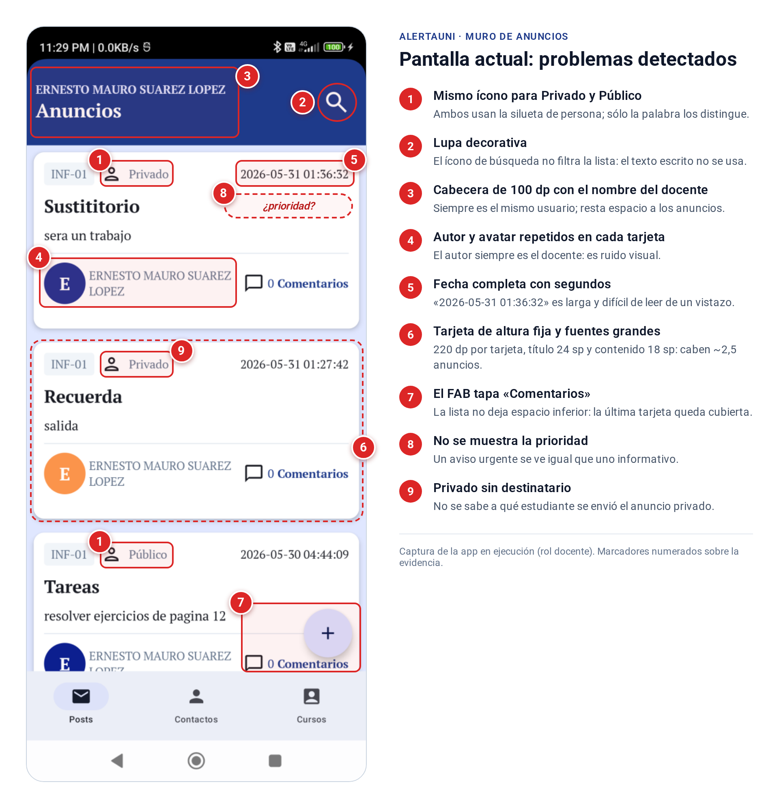
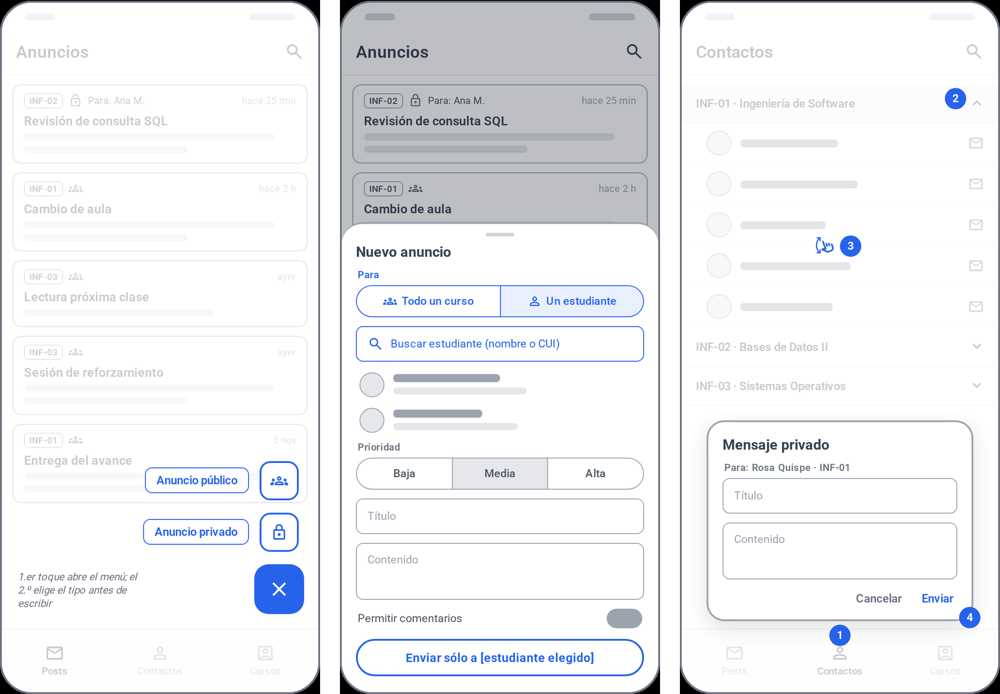
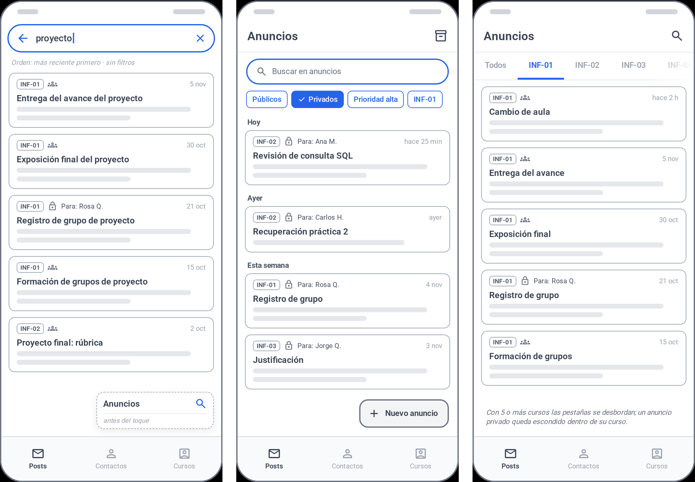
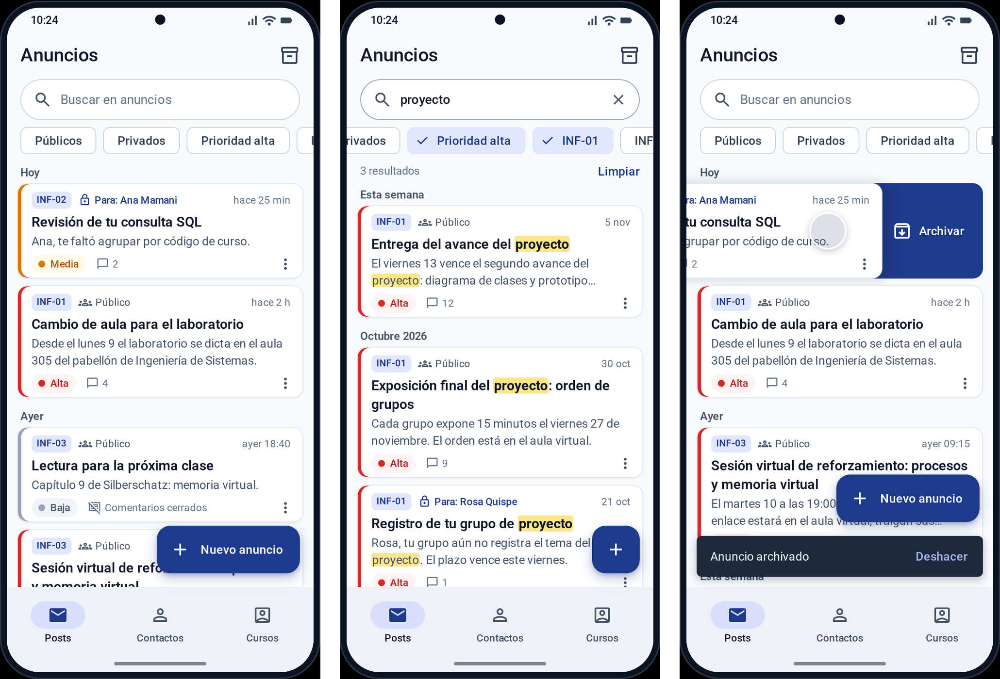
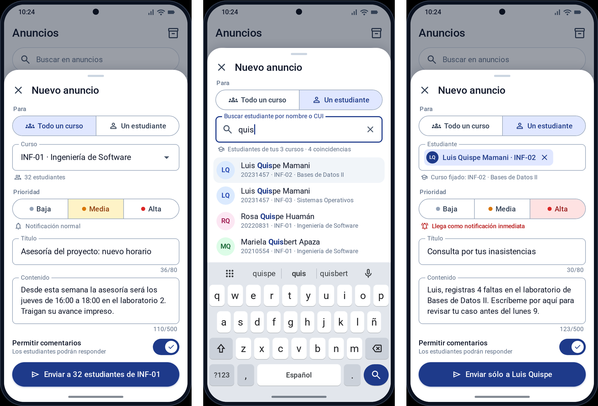
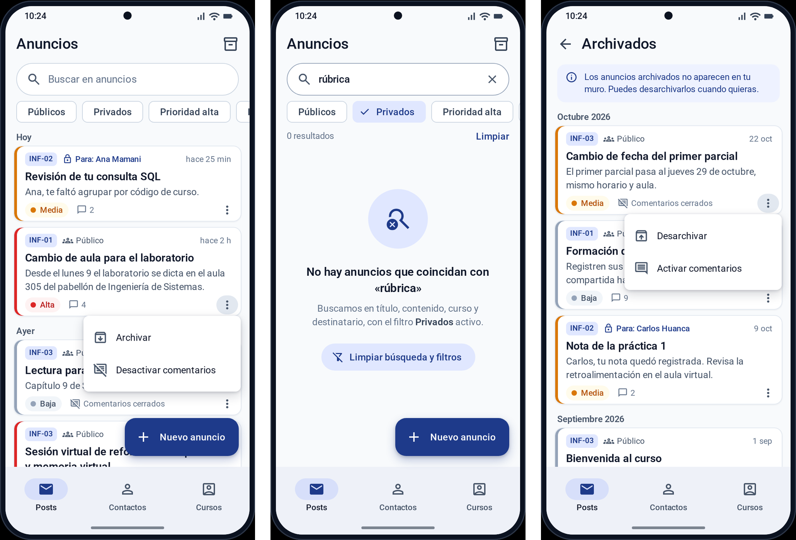
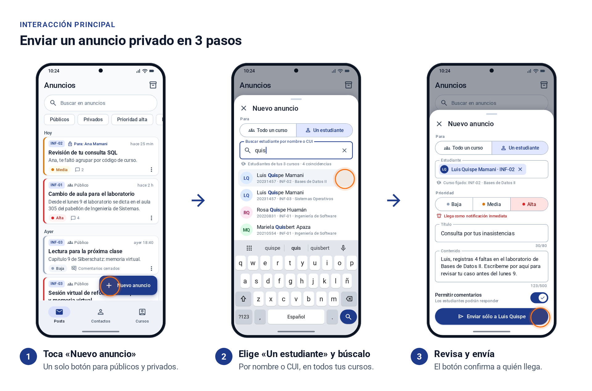

# Examen 2 – 2026B · Análisis y diseño del Muro de Anuncios

**Curso:** Introducción al Desarrollo de Nuevas Plataformas (E) · **Docente:** Mg. Ernesto Suárez López\
**Aplicativo:** AlertaUNI (`com.erns.alertauni`) – Android · Jetpack Compose · Hilt · Supabase\
**Grupo:** B7 — Adrian Issac Mamani Quispe · Daniel Wilston Chura Monroy · Johann Andre Cáceres Ruiz · Daniel Bedregal Pérez · Yourdyy Yossimar Huayhua Hillpa\
**Maquetas:** [`Docs/Examen2/maquetas/maquetas.html`](maquetas/maquetas.html) · **Prototipo en Compose (opcional):** `screen/post/` y `domain/post/`

---

## 1. Análisis de la interfaz actual (Tarea 1)

### 1.1 Método

Evaluamos el Muro de Anuncios del docente (`PostScreen.kt`, Figura 1) de tres formas complementarias:

1. **Recorrido de tareas** del docente con la app y el código: *T1* publicar un anuncio público, *T2* enviar un anuncio privado a un estudiante, *T3* encontrar un anuncio entre muchos, *T4* archivar un anuncio.
2. **Heurísticas de usabilidad de Nielsen** (visibilidad del estado, reconocer antes que recordar, prevención de errores, diseño minimalista, consistencia).
3. **Revisión del código** de la pantalla para confirmar cada problema con evidencia y no sólo con la captura.

Alcance acordado con el docente: sólo la pantalla principal del muro (no el chat de comentarios) y sólo orientación vertical.



### 1.2 Problemas identificados

**Tabla 1.** Problemas de diseño de la interfaz actual.

| # | Criterio | Problema | Evidencia | Por qué dificulta la experiencia |
|--|--------|----------------------|------------------|------------------------|
| 1 | Componentes | Público y Privado usan **el mismo ícono** de persona; sólo los diferencia una palabra gris de 16 sp. | `Icons.Outlined.Person` para ambos tipos en `MessageCard` | El tipo es el dato que más importa al docente (¿quién lo vio?) y es el menos visible. El ícono no comunica nada. |
| 2 | Interacción | **La lupa no busca.** Abre un campo de texto que no está conectado a la lista. | `searchQuery` se crea en `PostScreen` y nunca se usa; `SearchBoxComponent` tiene su propio `query` | Rompe la expectativa del usuario: escribe y no pasa nada. Con muchos anuncios sólo queda hacer scroll. |
| 3 | Organización | Cabecera azul de 100 dp con el **nombre del docente** y un título de 26 sp. | `SearchBoxComponent`, `height(100.dp)` | Ocupa ~13 % de la pantalla con un dato que el docente ya sabe. |
| 4 | Organización | **Autor y avatar** en cada tarjeta. | `UserInitialCircle(announce.authorName)` | Siempre es el propio docente (el enunciado lo excluye). Repite el mismo nombre en todas las tarjetas. |
| 5 | Organización | **Fecha con segundos** `2026-05-31 01:36:32`. | `Text(announce.date)` | Es larga y difícil de leer; al docente le importa "hace cuánto", no el segundo exacto. |
| 6 | Organización | Tarjetas de **altura fija** (220 dp) con título de 24 sp y contenido de 18 sp. | `Card(...height(220.dp))` | Un texto largo se corta y uno corto deja huecos. Sólo caben unos 2,5 anuncios por pantalla. |
| 7 | Componentes | El **FAB tapa** el botón "Comentarios" de la última tarjeta. | `LazyColumn` sin `contentPadding` inferior | El último anuncio no se puede abrir desde su botón. |
| 8 | Componentes | **No se muestra la prioridad** (alta, media o baja). | `PostEntity` y `PostRequest` no tienen prioridad | Un aviso urgente se ve igual que uno informativo, y el enunciado exige mostrarla. |
| 9 | Componentes | Un anuncio privado **no dice a quién** se envió. | `receiverPrivate` existe en `PostEntity` pero no se dibuja | El docente no puede saber, desde el muro, a qué estudiante le escribió. |
| 10 | Interacción | Toda la tarjeta y el botón "Comentarios" hacen lo mismo, y **no hay acciones de gestión** (archivar, activar o desactivar comentarios). | `Modifier.clickable` + botón con el mismo `onClickComment` | Dos objetivos para una sola acción y ninguna forma de ordenar el muro. |
| 11 | Interacción | El **envío privado está escondido** en otra pestaña (Contactos → curso → scroll → estudiante → diálogo). El "+" del muro sólo publica públicos. | `PostViewModel.sendPost` fija `is_private = false`; el privado vive en `TeacherContactScreen` | El docente no sabe que existe y debe recordar dónde está (heurística *reconocer antes que recordar*). Además no puede elegir prioridad ni si se permiten comentarios. |

### 1.3 Recorrido de las tareas en la interfaz actual

| Tarea | Pasos hoy | Observación |
|--------------|------------------------------|-----------------------|
| T1 · Publicar público | "+" → elegir curso → título → contenido → Enviar (5) | Funciona, pero no hay prioridad ni opción de comentarios. |
| T2 · Privado a un estudiante | Pestaña Contactos → elegir curso → scroll por la lista → tocar estudiante → título y contenido → Enviar (6 o más) | Hay que saber de antemano en qué curso está el estudiante y buscarlo a ojo. |
| T3 · Encontrar un anuncio | Scroll lineal | Con 4 cursos y 15 anuncios por curso (60 en total) son unas 24 pantallas de scroll. |
| T4 · Archivar | No existe | El muro sólo crece. |

**Qué conservamos:** la barra inferior (Posts · Contactos · Cursos), la paleta azul de la app, el "+" como punto de entrada para crear, el chip con el acrónimo del curso y el contador de comentarios. Funcionan y el usuario ya los conoce.

---

## 2. Propuesta de soluciones (Tarea 2)

Criterios de comparación, tomados del enunciado: **simplicidad** (pocos controles y pasos), **claridad de la interacción** (se entiende con sólo mirar) y **prevención de errores**. Agregamos el **costo de implementación** en Compose. Puntaje de 1 a 5.

### 2.1 Problema 1 — Envío de anuncios públicos y privados



- **A. Dos botones o FAB desplegable.** El "+" se abre en "Anuncio público" y "Anuncio privado".
  - *Ventajas:* el tipo se elige de forma explícita.
  - *Limitaciones:* son dos puntos de entrada y el docente debe decidir el tipo antes de pensar en el destinatario. Compose no trae un *speed dial* nativo, hay que construirlo con `AnimatedVisibility`. Además tapa más contenido.
- **B. Un solo botón "Nuevo anuncio" con campo «Para».** Una hoja inferior empieza por el destinatario: `Todo un curso | Un estudiante`.
  - En *Un estudiante*, un único buscador encuentra al alumno entre **todos** los cursos del docente, por nombre o CUI, y fija el curso automáticamente.
  - El botón de envío dice a quién llega: *"Enviar a 32 estudiantes de INF-01"* o *"Enviar sólo a Luis Quispe"*.
  - *Ventajas:* un solo flujo y destinatario siempre visible.
  - *Limitaciones:* hay un control más en el formulario y hay que cargar los estudiantes.
- **C. Mantener el privado en Contactos** y enlazarlo desde el muro.
  - *Ventajas:* casi no cambia el código.
  - *Limitaciones:* sigue siendo poco descubrible, toma 6 pasos o más y obliga a recorrer curso por curso.

**Tabla 2.** Comparación ponderada, Problema 1.

| Criterio (peso) | A. Dos botones | **B. Campo «Para»** | C. Contactos |
|---|:-:|:-:|:-:|
| Simplicidad (30 %) | 3 | **5** | 2 |
| Claridad de quién recibe (30 %) | 4 | **5** | 3 |
| Prevención de errores (25 %) | 3 | **5** | 3 |
| Costo de implementación (15 %) | 2 | **4** | 5 |
| **Total** | 3,15 | **4,85** | 3,00 |

**Elegimos B.** Resuelve el reto que planteó el docente: enviar un privado a un estudiante sin entrar al curso ni recorrer la lista. Lo hace con **un solo punto de entrada**, así que no hay botones duplicados. Previene errores en tres momentos:

1. **Antes:** el destinatario es la primera decisión y el curso se deduce del estudiante elegido.
2. **Durante:** el chip del estudiante elegido y el texto de ayuda de la prioridad informan del efecto de cada opción.
3. **Al confirmar:** el botón repite el destinatario, el envío se deshabilita mientras falten datos y cerrar con texto escrito pide confirmación.

### 2.2 Problema 2 — Visualización y búsqueda de anuncios



- **A. Lupa en la cabecera que se expande**, con la lista ordenada por fecha.
  - *Ventajas:* casi no ocupa espacio.
  - *Limitaciones:* la búsqueda queda escondida (el problema actual), no se pueden combinar filtros y no se sabe en qué campos busca.
- **B. Buscador siempre visible, chips de filtro y lista agrupada por fecha**, con tarjetas compactas.
  - El buscador mira título, contenido, curso y nombre del destinatario, sin distinguir mayúsculas ni tildes, y resalta las coincidencias.
  - Los chips filtran por tipo, prioridad alta y curso.
  - Los encabezados *Hoy · Ayer · Esta semana · Mes* dan orientación temporal.
  - *Ventajas:* todo se ve de un vistazo y se combina.
  - *Limitaciones:* ocupa unos 100 dp arriba, espacio que se recupera al quitar la cabecera de 100 dp y compactar las tarjetas.
- **C. Pestañas por curso** (`ScrollableTabRow`) con búsqueda.
  - *Ventajas:* separa los cursos.
  - *Limitaciones:* con 5 o más cursos las pestañas se desbordan, no se puede buscar entre cursos y un privado queda escondido dentro de su curso.

**Tabla 3.** Comparación ponderada, Problema 2.

| Criterio (peso) | A. Lupa | **B. Buscador + chips** | C. Pestañas |
|---|:-:|:-:|:-:|
| Rapidez para encontrar (30 %) | 3 | **5** | 3 |
| Visibilidad / descubrimiento (25 %) | 2 | **5** | 4 |
| Escala con muchos cursos y anuncios (20 %) | 3 | **5** | 2 |
| Espacio en pantalla (15 %) | 5 | **3** | 3 |
| Costo de implementación (10 %) | 5 | **4** | 4 |
| **Total** | 3,25 | **4,60** | 3,15 |

**Elegimos B** y lo complementamos con decisiones sobre la información de cada tarjeta (Tabla 4) para que entren más anuncios por pantalla sin perder ningún dato obligatorio.

**Tabla 4.** Información de cada anuncio: antes y después.

| Dato (enunciado) | Antes | Después | Motivo |
|-----------|-------------|---------------------|---------------------|
| Acrónimo del curso | Chip gris | Se mantiene | Ya era claro y compacto. |
| Tipo | Ícono igual + palabra | Ícono distinto: grupo (público) o candado (privado) + **"Para: nombre"** en privados | El ícono basta para el tipo; en el privado lo importante es a quién. |
| Título y contenido | 24 sp / 18 sp, altura fija | 16 sp / 14 sp, contenido en 2 líneas con "…" | La tarjeta se adapta al texto. El detalle completo está al tocarla. |
| Prioridad | No existía | Franja lateral de color + etiqueta *Alta / Media / Baja* | El color se ve de lejos y el texto no depende del color (daltonismo). |
| N.º de comentarios | Botón de texto | Ícono + número, o "Comentarios cerrados" | Muestra también si los comentarios están activos. |
| Fecha y hora | `2026-05-31 01:36:32` | *hace 2 h · ayer 14:30 · 31 may* | Más corta y fácil de leer. La fecha exacta se ve en el detalle. |
| Autor | Avatar + nombre | Se elimina | Siempre es el propio docente. |

**Archivar.** Se hace deslizando la tarjeta hacia la izquierda o desde el menú ⋮. Aparece un Snackbar con **Deshacer**, y los archivados se ven en su propia vista (ícono de archivo en la barra superior). Así el muro queda despejado sin perder nada. El menú ⋮ también permite **activar o desactivar los comentarios** de cada anuncio.

---

## 3. Diseño de la interfaz (Tarea 3)

### 3.1 Maquetas

Las maquetas están en `Docs/Examen2/maquetas/` (HTML navegable y PNG). Usan la paleta y tipografía de la app.









### 3.2 Interacciones principales del docente

| Acción | Gesto | Resultado / retroalimentación |
|-----------|---------------------|-------------------------------|
| Buscar | Escribir en el buscador | La lista se filtra mientras escribe, las coincidencias se resaltan y aparece "N resultados · Limpiar". |
| Filtrar | Tocar chips (Públicos, Privados, Prioridad alta, curso) | Se combinan con el texto. "Limpiar" quita todos. |
| Abrir comentarios | Tocar la tarjeta | Pantalla de comentarios (sin cambios). |
| Archivar | Deslizar a la izquierda o ⋮ → Archivar | Snackbar "Anuncio archivado · Deshacer". |
| Comentarios on/off | ⋮ → Desactivar / Activar comentarios | La tarjeta muestra "Comentarios cerrados". |
| Nuevo anuncio | Botón "Nuevo anuncio" (se contrae a "+" al hacer scroll) | Hoja inferior con *Para → curso o estudiante → prioridad → texto → Enviar a…* |

### 3.3 Layouts y componentes de Jetpack Compose

Sólo los que influyen en el diseño o la interacción:

| Decisión de diseño | Layout / componente | Por qué este y no otro |
|----------------|---------------------|-----------------------|
| Estructura de la pantalla | `Scaffold` + `TopAppBar` | Coloca barra, contenido, FAB y Snackbar sin superponerse. |
| Búsqueda siempre visible | `OutlinedTextField` con ícono de búsqueda y botón limpiar (o `SearchBarDefaults.InputField`) | Visible sin un toque previo. El estado del texto vive en el `ViewModel`. |
| Filtros combinables | `LazyRow` + `FilterChip` | Chip seleccionado con check: el estado del filtro se ve. Se desplaza si hay muchos cursos. |
| Lista larga agrupada | `LazyColumn` + `stickyHeader` + `items(key = id)` | Sólo compone lo visible. Los encabezados por fecha quedan fijos al hacer scroll. |
| Tarjeta adaptable | `Card` + `Row`/`Column` sin altura fija, `maxLines = 2` + `TextOverflow.Ellipsis` | Corrige la altura fija de 220 dp. |
| Resaltar coincidencias | `buildAnnotatedString` + `SpanStyle` | Muestra por qué apareció cada resultado. |
| Archivar con gesto | `SwipeToDismissBox` | Gesto estándar de Material 3. Se complementa con el menú para quien no conoce el gesto. |
| Deshacer | `SnackbarHostState.showSnackbar(actionLabel = "Deshacer")` | Prevención de errores sin diálogos de confirmación que interrumpen. |
| Acciones de la tarjeta | `DropdownMenu` desde `IconButton` ⋮ | Agrupa acciones secundarias sin ensuciar la tarjeta. |
| Crear anuncio | `ExtendedFloatingActionButton(expanded = …)` | Texto explícito "Nuevo anuncio" que se contrae al hacer scroll para no tapar contenido. |
| Formulario de envío | `ModalBottomSheet` | Mantiene el contexto del muro y se adapta al teclado. Reemplaza al `Dialog` actual. |
| Público / privado y prioridad | `SingleChoiceSegmentedButtonRow` + `SegmentedButton` | Opciones excluyentes y visibles a la vez, mejor que un desplegable. |
| Estudiante elegido | `InputChip` con ✕ | Confirma la selección y permite quitarla con un toque. |
| Comentarios al crear | `Switch` | Control binario estándar. |

---

## 4. Justificación y evaluación de la propuesta (Tarea 4)

### 4.1 ¿Por qué es más adecuada que la actual?

| Indicador | Actual | Propuesta |
|--------------------|-------------------|-------------------|
| Anuncios visibles por pantalla | ~2,5 | ~4,5 |
| Pasos para un privado (T2) | 6 o más, en otra pestaña | 5, sin salir del muro y sin saber el curso |
| Encontrar un anuncio (T3) | Sólo scroll | Escribir o tocar un chip |
| Datos obligatorios mostrados | Faltan prioridad y destinatario | Todos |
| Archivar (T4) | No existe | Deslizar o menú, con Deshacer |
| Elementos redundantes | Nombre del docente ×2 por tarjeta + cabecera | Ninguno |

### 4.2 Decisiones que la hacen simple e intuitiva

- **Un solo punto de entrada para crear.** El tipo de anuncio sale de responder "¿para quién?", que es como piensa el docente.
- **El destinatario siempre visible:** primero en el formulario, en el chip, en el botón y en la tarjeta.
- **Reconocer en vez de recordar:** el buscador y los filtros están a la vista, y los íconos de tipo son distintos y con significado.
- **Menos es más:** se quitaron el autor, el avatar, la cabecera de 100 dp y los segundos de la fecha. Esto deja el espacio para la prioridad y para más anuncios.
- **Prevención y reversibilidad:** el envío se deshabilita mientras faltan datos, cerrar con texto escrito pide confirmación y archivar se puede deshacer.
- **Consistencia con Material 3:** chips, segmentados, deslizar y Snackbar se comportan como en otras apps Android.

### 4.3 Dificultades que podría tener el usuario (y cómo las mitigamos)

| Dificultad | Mitigación |
|---------------------------|-----------------------------------|
| No descubrir el gesto de deslizar para archivar | La misma acción está en el menú ⋮. |
| Archivar por error | Snackbar con Deshacer y vista de Archivados. |
| Usar prioridad Alta en todo y saturar a los estudiantes con notificaciones | Prioridad Media por defecto y texto de ayuda: "Llega como notificación inmediata". |
| Estudiantes con nombres parecidos | El resultado muestra el CUI y el curso, y se puede buscar por CUI. |
| Mismo estudiante en dos cursos del docente | Aparece una vez por curso, así el docente elige el contexto. |
| Buscador y chips ocupan espacio en pantallas pequeñas | Se compensa con la cabecera eliminada y tarjetas compactas; la barra superior puede ocultarse al hacer scroll. |
| La fecha relativa es ambigua en anuncios viejos | Después de 7 días se muestra la fecha ("31 may") y la exacta está en el detalle. |

También hay **dificultades de implementación**. `stickyHeader` y algunas APIs de `SearchBar` son experimentales en Material 3 y cambian entre versiones. El FAB que se contrae requiere observar el estado de scroll. El backend aún no guarda la **prioridad** ni el **archivado**: hacen falta las columnas `post.priority` y `post.archived_at` y una función para actualizar el anuncio. Por eso, en el prototipo esos datos viven sólo en el cliente (sección 5).

### 4.4 ¿Cómo comprobaríamos que facilita las tareas del docente?

1. **Prueba de usabilidad con 5 participantes:** docentes o, en su defecto, estudiantes en el rol de docente. Cada uno hace T1–T4 en la versión actual y en el prototipo, en orden alternado, pensando en voz alta.
2. **Métricas por tarea:**
   - Tasa de éxito.
   - Tiempo.
   - Número de toques.
   - **Errores críticos:** enviar a un destinatario equivocado o archivar sin querer.

   Metas: T2 en menos de 30 s, T3 en menos de 15 s y cero envíos al destinatario equivocado.
3. **Prueba de 5 segundos:** se muestra el muro y se pregunta cuáles anuncios son privados y cuáles urgentes. Mide si los íconos y la prioridad se entienden sin explicación.
4. **Cuestionario SUS** al final (meta: 68 puntos o más) y comentarios abiertos.
5. **En producción:** métricas de uso de búsqueda y filtros, tasa de "Deshacer" (si es alta, el gesto confunde) y anuncios enviados por prioridad.

---

## 5. Prototipo en Jetpack Compose (opcional)

Para comprobar que el diseño es implementable con las APIs del proyecto, construimos un prototipo del muro y de la hoja de nuevo anuncio. Compila (`./gradlew :app:assembleDebug`) y tiene **41 pruebas unitarias** que pasan (`./gradlew :app:testDebugUnitTest`): filtro, fecha relativa, prioridad, destinatario y formato JSON de los modelos.

- **Real, con el backend actual:**
  - Lista de anuncios.
  - Envío público (`service-post-add`) y privado (`service-post-private-add`, que ya existía para Contactos).
  - `allow_comments` al crear.
  - Estudiantes de cada curso (`service-course-student`).
- **Sólo en el cliente (prototipo):** prioridad, archivado y activar o desactivar comentarios de un anuncio ya publicado. Se guardan en memoria del `ViewModel`. Los modelos ya tienen el campo opcional `priority` para cuando el backend lo devuelva.
- **Lógica pura y probada** (`domain/post/`): filtro por texto, tipo, curso y prioridad sin tildes ni mayúsculas, fecha relativa y agrupación por día.
- **Roles:** el estudiante sigue viendo el muro como antes. En la hoja de nuevo anuncio no tiene la opción «Un estudiante», y en sus anuncios privados aparece «Para ti».
- **No probado en dispositivo:** el prototipo se verificó compilando y con pruebas unitarias. El repositorio no incluye las claves reales de Supabase, así que no se puede ejecutar contra el backend.

**Fragmentos clave** (el código completo está en el repositorio, rama `main`):

```kotlin
// domain/post/AnnouncementFilter.kt — filtro puro: tipo, prioridad y curso con Y; cada palabra
// buscada debe aparecer en algún campo, sin distinguir mayúsculas ni tildes.
if (query.onlyHigh && item.priority != Priority.ALTA) return false
val terms = terms(query.text)
if (terms.isEmpty()) return true
val haystack = normalize(listOf(item.title, item.content, item.courseCode,
    item.courseName, item.recipientName.orEmpty()).joinToString("\n"))
return terms.all { haystack.contains(it) }
```

```kotlin
// domain/post/Audience.kt — el botón dice a quién llega el anuncio (prevención de errores)
val sendLabel: String
    get() = when {
        recipientName != null -> "Enviar sólo a $recipientName"
        hasCount -> "Enviar a ${students()} de $courseCode"
        else -> "Publicar en $courseCode"
    }
```

```kotlin
// screen/post/PostScreen.kt — archivar es reversible: Snackbar con "Deshacer"
is PostEvent.ArchivedChanged -> {
    val result = snackbarHostState.showSnackbar(
        message = if (event.archived) "Anuncio archivado" else "Anuncio desarchivado",
        actionLabel = "Deshacer", duration = SnackbarDuration.Long)
    if (result == SnackbarResult.ActionPerformed)
        postViewModel.setArchived(event.postId, !event.archived, notify = false)
}
```

**Errores existentes encontrados al construir el prototipo** (los reportamos, no forman parte del rediseño):

- `PostPrivateResponse` espera un campo `published` que el backend no envía. Por eso el envío privado desde Contactos informa error aunque el anuncio sí se crea. El prototipo usa un método nuevo, `PostRepository.sendPostPrivate`, que lee `{post_id, created_at}`.
- En `service-post-add/index.ts` se usa `courseCatalogIDs` sin definirlo. Si la función desplegada es igual a la del repositorio, publicar un anuncio público falla en el servidor.


---

## Anexo A. Uso de IA: principales preguntas y respuestas

Usamos **Claude (Claude Code)** como apoyo para revisar el enunciado, analizar el código y prototipar. Las decisiones finales, los pesos de las matrices y la verificación son del grupo.

| # | Pregunta al asistente | Respuesta resumida | Qué verificamos o decidimos |
|--|----------------|------------------------|------------------|
| 1 | Revisa el enunciado y el video de indicaciones del docente: ¿qué pide exactamente? | Resumió las 4 tareas y las indicaciones del video: sólo la pantalla del muro, sólo vertical, quitar el autor, fecha muy larga, ícono para público o privado, reto del privado entre varios cursos, máximo unas 10 páginas, anexar el uso de IA. | Contrastamos con el PDF y el video. |
| 2 | ¿Qué problemas de diseño tiene `PostScreen.kt`? | Listó el ícono repetido, la lupa sin efecto (`searchQuery` sin uso), la altura fija de 220 dp, el FAB que tapa contenido, el autor redundante, la falta de prioridad y el privado escondido en Contactos. | Confirmamos cada uno en el código (Tabla 1) y en la app. |
| 3 | ¿Cómo enviar públicos y privados sin dos botones y sin entrar al curso? | Propuso el speed dial, el campo «Para» con buscador entre cursos y el privado desde Contactos, con ventajas y limitaciones. | Definimos los criterios y pesos (Tabla 2) y elegimos B. |
| 4 | ¿Cómo encontrar rápido un anuncio entre muchos? | Propuso la lupa expandible, el buscador con chips y grupos por fecha, y las pestañas por curso. | Elegimos B y decidimos qué datos mostrar en la tarjeta (Tabla 4). |
| 5 | ¿Qué componentes de Compose implementan cada decisión? | Sugirió `FilterChip`, `stickyHeader`, `SwipeToDismissBox`, `ModalBottomSheet`, `SegmentedButton`, `InputChip` y `ExtendedFloatingActionButton`. | Comprobamos que existen en la versión de Material 3 del proyecto compilando el prototipo. |
| 6 | ¿Cómo comprobar que el diseño facilita las tareas? | Propuso una prueba de usabilidad con tareas, métricas, prueba de 5 segundos y SUS. | Fijamos las metas de tiempo y errores (sección 4.4). |
