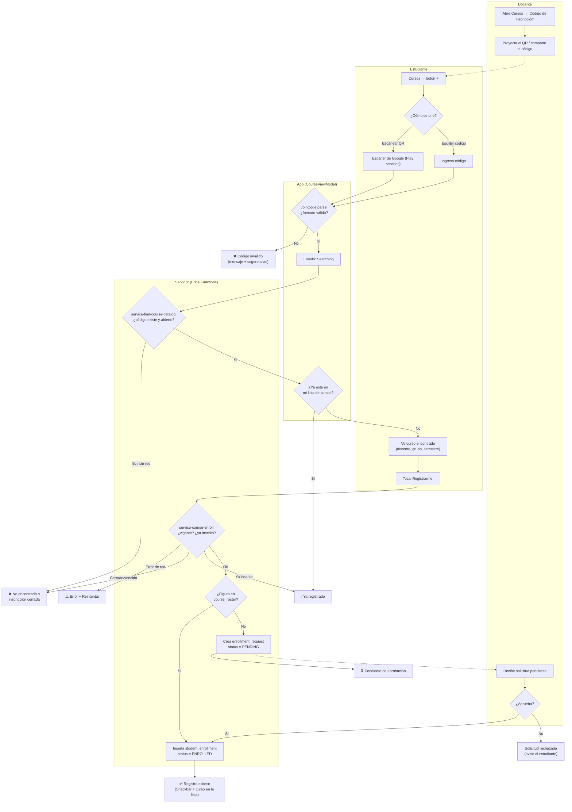
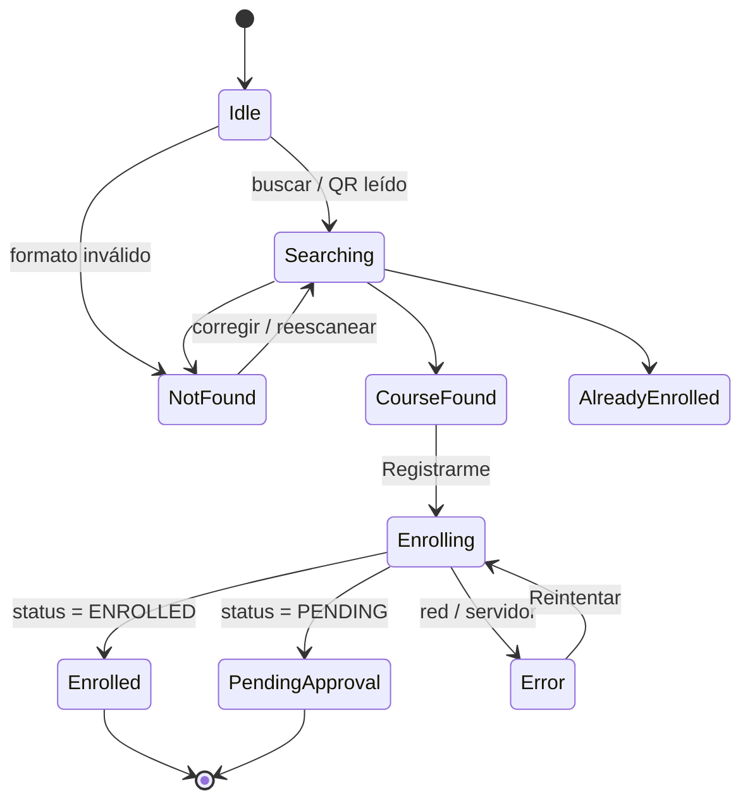

# Proyecto Integrador · Parte 1 — Incorporación de estudiantes a un curso

**Curso:** Introducción al Desarrollo de Nuevas Plataformas (E) · 2026B
**Aplicación:** AlertaUNI (Android · Jetpack Compose · Hilt · Supabase)
**Tema:** Diseño del proceso de incorporación de estudiantes a un curso
**Integrantes (Grupo B7):** Adrian Issac Mamani Quispe · Daniel Wilston Chura Monroy · Johann Andre Cáceres Ruiz · Daniel Bedregal Pérez · Yourdyy Yossimar Huayhua Hillpa
**Prototipo en Figma:** https://www.figma.com/design/AqF2iVRnerwYnCzoP5dmRH/Untitled?node-id=0-1&t=vNiKA47BuQ6gfWBF-1

---

## 1. Contexto y problema

AlertaUNI es un espacio de comunicación académica exclusivo entre el docente y los estudiantes de un curso, separado de los contactos y conversaciones personales (a diferencia de WhatsApp). Para que ese espacio funcione, **sólo las personas correctas deben entrar a cada curso**, y el ingreso tiene que ser rápido: normalmente ocurre durante los primeros minutos de la primera clase, con 30 a 60 estudiantes al mismo tiempo.

En el proyecto base este proceso estaba incompleto:
- Existía la búsqueda por **código de clase** (`service-find-course-catalog`) y la inscripción (`service-course-enroll`), pero sin retroalimentación de errores, sin control de vencimiento y **sin validar si el estudiante está matriculado**: cualquiera que conociera el código podía entrar.
- El docente no tenía forma de ver ni compartir el código desde la app.

**Necesidades identificadas**

| Actor | Necesidad | Restricción |
|---|---|---|
| Estudiante | Unirse en segundos, sin escribir códigos largos | Puede equivocarse al tipear (0/O, 1/I); puede no tener buena conexión en el aula |
| Docente | Que ingresen sólo sus estudiantes, sin tener que agregarlos uno por uno | Tiene poco tiempo en clase; algunos alumnos se matriculan tarde o no figuran aún en la lista oficial |
| Institución | Que el espacio sea privado del curso | Los datos de estudiantes no deben exponerse a terceros |

### Aplicaciones similares analizadas

| Aplicación | Mecanismo | Aprendizaje para AlertaUNI |
|---|---|---|
| **Google Classroom** | Código de clase (6–8 caracteres) + invitación por correo + enlace | El código es cómodo pero, si se filtra, cualquiera entra; Classroom permite **restablecer** y **desactivar** el código. → Incluir regenerar y cerrar inscripción. |
| **Microsoft Teams (Educación)** | Código de equipo o agregar miembros desde la lista | Agregar desde la lista es seguro pero laborioso para el docente. → Usar la lista para **validar automáticamente**, no para cargar manualmente. |
| **Moodle** | Automatriculación con **clave** y fecha límite | La clave con vencimiento reduce el riesgo de filtración. → Código con **vencimiento** (7 días). |
| **Kahoot / Mentimeter** | PIN + **QR proyectado** en el aula | En clase presencial el QR es lo más rápido para muchos alumnos a la vez. → El docente puede **proyectar** el QR. |
| **WhatsApp (grupos)** | Enlace de invitación | Sin control de quién entra; mezcla lo personal con lo académico. → Justifica un control de acceso más estricto. |

---

## 2. Evaluación de alternativas (4.1)

Alternativas consideradas: **(a)** código QR, **(b)** código alfanumérico, **(c)** invitación directa del docente desde la lista de matriculados, y **(d) propuesta híbrida**.

### Matriz de decisión ponderada

Escala 1 (muy desfavorable) a 5 (muy favorable). Los pesos priorizan el **control de acceso** y la **seguridad**, porque el propósito de la app es un espacio exclusivo del curso.

| Criterio | Peso | (a) QR | (b) Código | (c) Invitación | (d) Híbrida |
|---|---:|:---:|:---:|:---:|:---:|
| Facilidad de uso (general) | 0.15 | 5 | 3 | 4 | 5 |
| Posibilidad de errores (5 = pocos) | 0.15 | 5 | 2 | 4 | 5 |
| Control del acceso al curso | 0.20 | 2 | 2 | 5 | 5 |
| Seguridad | 0.15 | 3 | 2 | 5 | 4 |
| Facilidad para el docente | 0.10 | 4 | 5 | 2 | 4 |
| Facilidad para el estudiante | 0.10 | 5 | 3 | 5 | 5 |
| Viabilidad en Android | 0.15 | 4 | 5 | 3 | 4 |
| **Puntaje ponderado** | **1.00** | **3.90** | **2.95** | **4.05** | **4.60** |

**Criterios de puntuación usados**
- *Posibilidad de errores*: QR = el usuario no escribe nada; código = errores de tipeo frecuentes (0/O, 1/I, guiones); invitación = errores sólo si el correo en la lista está mal.
- *Control del acceso*: QR y código **por sí solos** dejan entrar a cualquiera que los obtenga (foto del QR compartida en un grupo); la invitación sólo admite a la lista.
- *Facilidad para el docente*: la invitación exige seleccionar o cargar estudiantes y hacer seguimiento a quienes no aceptan.
- *Viabilidad Android*: el código es un `TextField`; el QR requiere escáner (resuelto con Google code scanner, que depende de Play services); la invitación requiere notificaciones push y gestión de listas.

### Ventajas y limitaciones

| Alternativa | Ventajas | Limitaciones |
|---|---|---|
| (a) QR | Instantáneo; sin errores de tipeo; ideal para proyectar en clase | Si el alumno no está en el aula no puede escanear; una foto del QR se puede reenviar; requiere cámara/Play services |
| (b) Código | Funciona a distancia (correo, aula virtual); implementación simple | Errores de tipeo; se filtra fácilmente; sin control de quién entra |
| (c) Invitación | Máximo control; el alumno sólo acepta | Carga operativa del docente; depende de que la lista esté actualizada; alumnos matriculados tarde quedan fuera |

### Alternativa seleccionada: mecanismo híbrido

> **El QR y el código alfanumérico transportan el mismo token** (`alertauni://join?code=IDNP-7K3Q`). El estudiante elige escanear o escribir, y el servidor **valida contra la lista oficial de matriculados**: si figura, entra de inmediato; si no, queda en **"pendiente de aprobación"** y el docente acepta o rechaza.

**Justificación**
1. **Rapidez del QR** en el aula y **alcance del código** fuera de ella, con una sola validación en el servidor (un único endpoint, un único formato).
2. **Control de la invitación sin su costo operativo**: la lista se usa como filtro automático; el docente sólo interviene en los casos excepcionales (matrícula tardía, traslados).
3. **Mitiga la filtración**: aunque el QR circule, un externo no entra sin aprobación. Además el código **vence** (7 días), se puede **regenerar** y la inscripción se puede **cerrar**.
4. **Reduce errores**: el código generado evita caracteres ambiguos (sin 0/O/1/I/L) y la app valida el formato antes de llamar al servidor.
5. **Es viable** con la arquitectura actual: reutiliza `service-find-course-catalog`, `course_catalog.class_code` y `class_code_enable` que ya existían.

---

## 3. Flujo de registro (4.2)

### Flujo completo (actividad con carriles)

### Respuestas a lo que pide el enunciado

| Punto del flujo | Diseño |
|---|---|
| **Cómo inicia** | Estudiante: pestaña *Cursos* → botón **+**. Docente: tarjeta del curso → **Código de inscripción** (lo muestra, proyecta o comparte). |
| **Qué información proporciona / recibe el estudiante** | Proporciona el código (escaneado o escrito); su identidad (email institucional) la aporta la sesión de Google, no la escribe. Recibe: código, nombre del curso, docente, tipo, grupo, semestre y, al final, el resultado. |
| **Acciones del docente** | Ver/proyectar/copiar/compartir el código; **regenerarlo**; **abrir/cerrar** la inscripción; **aprobar o rechazar** solicitudes de no matriculados. |
| **Cómo se valida** | 1) En la app: formato con `JoinCode.parse` y "ya registrado" contra la lista local. 2) En el servidor: código existente, inscripción abierta y **no vencida**, alumno no inscrito, rol = estudiante, y **pertenencia a `course_roster`**. |
| **Registro exitoso** | Se inserta en `student_enrollment`, la lista de cursos se recarga, se muestra "Registro exitoso" y un Snackbar; el alumno ya ve los anuncios del curso. |
| **Error o no completado** | Código inválido (formato o inexistente/cerrado), ya registrado, pendiente de aprobación, error de red con **Reintentar** (sin perder el curso encontrado), escáner no disponible → ingreso manual. |

### Estados de la interfaz (máquina de estados)

---
