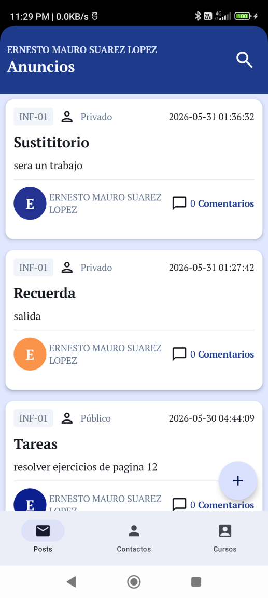
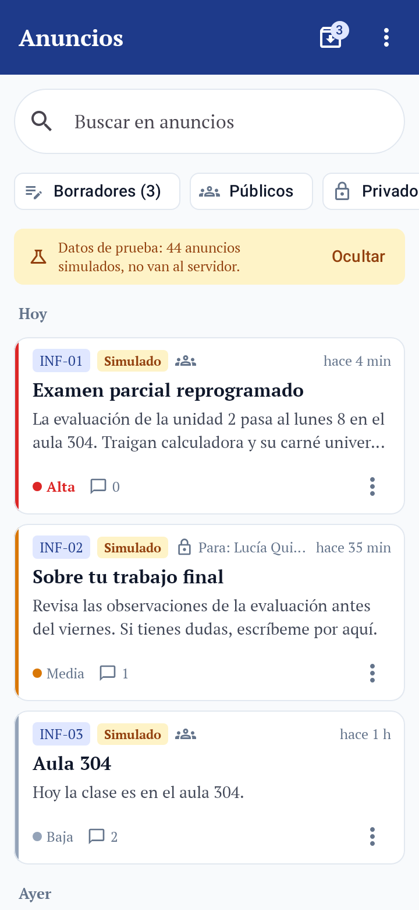

# Proyecto Integrador · Parte 2 — Implementación y validación del Muro de Anuncios

**Grupo B7** — Adrian Issac Mamani Quispe · Daniel Wilston Chura Monroy · Johann Andre Cáceres Ruiz · Daniel Bedregal Pérez · Yourdyy Yossimar Huayhua Hillpa
**Base:** diseño del Examen 2 ([`Docs/Examen2/INFORME_EXAMEN2.md`](../Examen2/INFORME_EXAMEN2.md)), implementado en Jetpack Compose sobre la app del curso, con MVVM.

## 1. Qué se implementó

| Tarea | Implementación | Dónde |
|---|---|---|
| **T1** Interfaz | Muro compacto con grupos por fecha, buscador siempre visible, chips de filtro, tarjeta con prioridad y destinatario, hoja «Nuevo anuncio» con campo **Para** | `screen/post/PostScreen.kt`, `AnnouncementCard.kt`, `NewAnnouncementSheet.kt` |
| **T2A** Anuncio privado | Se busca al estudiante entre **todos** los cursos (nombre o CUI), el curso se fija solo, se envía a `service-post-private-add` y la tarjeta muestra «Para: nombre» | `PostViewModel.send`, `PostRepository.sendPostPrivate` |
| **T2B** Búsqueda | Título, contenido, curso y destinatario, sin tildes ni mayúsculas; se actualiza al escribir; mensaje «No hay anuncios que coincidan» + «Limpiar búsqueda y filtros» para volver a la lista completa | `domain/post/AnnouncementFilter.kt` |
| **T3** Borradores | **Room** (`announcement_drafts`), por cuenta; «Guardar borrador» en la hoja y al cerrar con cambios; vista «Borradores (n)» con tarjetas punteadas; reabrir y seguir editando; al enviar se borra el borrador | `data/local/DraftDao.kt`, `data/repository/DraftRepository*.kt`, `domain/post/Draft.kt`, `screen/post/DraftCard.kt` |
| **T4A** 40+ anuncios | 44 anuncios de prueba (públicos y privados, 3 prioridades, ~60 días, textos cortos y largos, 4 cursos) activables desde ⋮ → «Datos de prueba (simulados)» | `data/demo/DemoAnnouncements.kt` |

Migración real de la base local **2 → 3** (`data/local/Migrations.kt`): crea las tablas nuevas sin borrar las notificaciones guardadas.

## 2. Qué es real, qué es local y qué es simulado

| Funcionalidad | Origen |
|---|---|
| Lista de anuncios, envío público y privado, `allow_comments` al crear, comentarios, estudiantes por curso | **Backend (Supabase)** |
| Borradores (crear, editar, eliminar con Deshacer), separados por cuenta (uid o correo) | **Local – Room** (`announcement_drafts`) |
| Prioridad, archivado, activar/desactivar comentarios de un anuncio publicado | **Local – Room** (`post_local_state`, por cuenta). No se sincroniza con el servidor; la app lo indica con «en este dispositivo» |
| Interruptor «Datos de prueba» | **Local – DataStore** |
| 44 anuncios de prueba | **Simulado** (`DemoAnnouncements`): ids negativos, etiqueta **«Simulado»** en la tarjeta, banner amarillo, nunca llaman al backend |

Dentro de la app, ⋮ → **«Origen de los datos»** muestra esta misma leyenda.

## 3. Capturas y mejoras respecto a la versión original

Las capturas se generan desde los **composables reales** con datos de prueba (Roborazzi + Robolectric, 360×780 dp): `./gradlew :app:testDebugUnitTest -PgrabarCapturas`. Sin claves de Supabase la app no pasa del login, por eso no son capturas de un emulador.

| Original | Ahora |
|---|---|
|  |  |

| Captura | Mejora frente a la original |
|---|---|
| [01 Muro con 44 anuncios](capturas/01-muro-40-anuncios.png) | Sin cabecera de 100 dp ni autor repetido; tarjetas de alto variable (≈4 por pantalla vs 2,5); prioridad visible; fecha relativa; ícono distinto público/privado |
| [02 Búsqueda](capturas/02-busqueda.png) | La lupa original no filtraba; ahora filtra al escribir y resalta coincidencias |
| [03 Sin resultados](capturas/03-sin-resultados.png) | Mensaje claro y botón para volver a la lista completa |
| [04 Filtro Privados](capturas/04-filtro-privados.png) | Cada privado dice a quién se envió |
| [05 Nuevo privado](capturas/05-nuevo-privado.png) | Antes el privado estaba escondido en Contactos; ahora está en el mismo botón «Nuevo anuncio» |
| [06 Guardar borrador](capturas/06-guardar-borrador.png) · [06b Cerrar con cambios](capturas/06b-cerrar-con-cambios.png) | Nuevo: no se pierde lo escrito |
| [07 Lista de borradores](capturas/07-lista-borradores.png) · [08 Editar borrador](capturas/08-editar-borrador.png) | Nuevo: borradores distinguibles (borde punteado, etiqueta «Borrador», «Editado hace…») |
| [09 Datos de prueba](capturas/09-datos-de-prueba-menu.png) · [11 Origen de los datos](capturas/11-origen-de-los-datos.png) | Diferencia explícita entre simulado, local y backend |
| [10 Archivados](capturas/10-archivados.png) | Nuevo: el muro se mantiene despejado; archivar se puede deshacer |

## 4. Pruebas de funcionamiento (T4A)

Automatizadas: **90 pruebas** (`./gradlew :app:testDebugUnitTest`), entre ellas:

| Qué se comprueba | Prueba |
|---|---|
| Hay ≥40 anuncios de prueba con variedad de tipo, prioridad, fecha, curso y longitud | `DemoAnnouncementsTest` |
| Búsqueda por título/contenido sin tildes ni mayúsculas; combinación con filtros | `AnnouncementFilterTest` |
| Borradores separados por cuenta; guardar de nuevo actualiza el mismo; persisten al cerrar y reabrir la base; la migración 2→3 conserva las notificaciones | `LocalStorageTest` (Room real con Robolectric) |
| Reglas del borrador (cuándo se puede guardar/enviar) y conversión formulario ↔ entidad | `DraftRulesTest`, `DraftMapperTest` |
| El muro mezcla correctamente anuncios del backend, estado local y datos simulados (sólo para el docente) | `PostUiStateBuilderTest` |
| Fecha relativa, prioridad, destinatario del botón, formato JSON de los modelos | pruebas del Examen 2 |

**Pendiente en dispositivo** (el grupo lo marca al probar con la app instalada):

- [ ] Publicar un anuncio público y verlo en el muro.
- [ ] Enviar un privado y ver «Para: nombre» en la tarjeta.
- [ ] Abrir comentarios de un anuncio (funcionalidad existente).
- [ ] Cerrar la app, reabrirla y ver los borradores.
- [ ] Cerrar sesión, entrar con otra cuenta y comprobar que no aparecen los borradores de la primera.
- [ ] Rol estudiante: el muro y los comentarios siguen funcionando.

## 5. Pruebas de usabilidad (T4B)

Protocolo, tareas y tablas de registro: [`PRUEBAS_USABILIDAD.md`](PRUEBAS_USABILIDAD.md). Se hacen con al menos 2 personas ajenas al grupo.

## 6. Evaluación y mejoras (T4C)

**Decisiones del examen que se mantuvieron:** un solo botón «Nuevo anuncio» con campo **Para** (curso o estudiante); buscador siempre visible con chips; grupos por fecha; tarjeta compacta con franja de prioridad; archivar deslizando con Deshacer.

**Decisiones que se modificaron o agregaron, y por qué:**

| Cambio | Motivo |
|---|---|
| Prioridad, archivado y comentarios on/off pasaron de memoria a **Room** | El enunciado exige almacenamiento persistente; el backend aún no tiene esas columnas |
| Nuevo: **borradores** con vista propia y diálogo al cerrar con cambios | Tarea 3; además evita perder texto escrito |
| Nuevo: interruptor **Datos de prueba** con etiqueta «Simulado» y leyenda de origen | Tarea 4A y la consideración de distinguir lo simulado de lo integrado |
| `PostScreen` separado en `PostContent` (sin estado) + `PostUiStateBuilder` (función pura) | Permite probar la pantalla y generar capturas sin backend, respetando MVVM |

**Problemas encontrados en las pruebas de usabilidad y mejoras aplicadas:** ver la tabla final de [`PRUEBAS_USABILIDAD.md`](PRUEBAS_USABILIDAD.md) (se completa con los resultados reales).

## 7. Limitaciones conocidas

- No se ejecutó contra el backend real ni en un dispositivo desde este repositorio (no incluye claves de Supabase); se verificó compilando, con pruebas unitarias y con renders Robolectric.
- El estado local (prioridad, archivado, comentarios) no se sincroniza: desactivar comentarios localmente no impide comentar en el servidor.
- Un borrador sólo se puede reabrir si cargan los cursos del docente.
